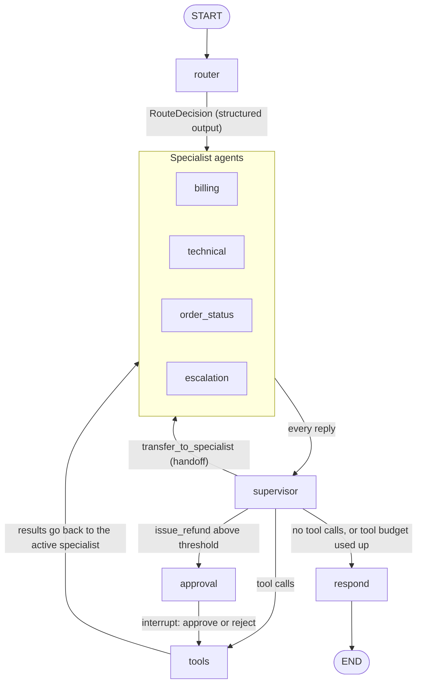

# langgraph-support-agent

A multi-agent customer-support workflow built with [LangGraph](https://github.com/langchain-ai/langgraph)
and served with FastAPI.

A router classifies each customer message with structured output and hands it to one of four
specialist agents (billing, technical support, order status, escalations). Each specialist has its
own tools, which run against a local SQLite demo database and a small Markdown knowledge base. A
supervisor node sits between the specialists and their tools: it enforces a per-turn tool-call
budget, arbitrates handoffs between specialists, and pauses the graph with `interrupt` when a
refund is above a configurable amount, so that a human can approve or reject it. Threads are
persisted with a SQLite checkpointer, so a conversation that is waiting for approval survives a
restart.

It runs with zero credentials: the default `fake` provider is a scripted chat model driven by a
rule-based policy, and it exercises the same graph, tools, approvals and handoffs as a real model.
Set `SUPPORT_PROVIDER=openai` to use OpenAI or any OpenAI-compatible server such as Ollama.

## The graph



| Node | What it does |
| --- | --- |
| `router` | Calls the model with `with_structured_output(RouteDecision)` to pick `billing`, `technical`, `order_status` or `escalate`. Unparseable output falls back to `escalate`. Resets the per-turn counters. |
| specialists | One node per specialist. Each binds its own tools plus `transfer_to_specialist` and sees the whole thread. |
| `supervisor` | Decides what happens to a specialist reply: finish, run tools, ask for approval, or hand off. Refuses handoffs to self, to a specialist that already handled the turn, or beyond `SUPPORT_MAX_HANDOFFS`. Stops the turn when the next tool calls would exceed `SUPPORT_MAX_TOOL_STEPS`. |
| `approval` | Calls `interrupt()` with the pending refunds. The resume value is validated as a `ReviewDecision`. It has no side effects before the interrupt, because LangGraph re-runs the node on resume. |
| `tools` | Validates arguments with pydantic, applies the conversation's customer scope, runs the tool and returns a `ToolMessage`. Validation and business-rule errors go back to the model as error results. |
| `respond` | Sets `final_response`. If the tool budget was exhausted it opens a high-priority ticket and tells the customer its number. |

### Tools

| Tool | Billing | Technical | Order status | Escalation |
| --- | :---: | :---: | :---: | :---: |
| `lookup_order` | yes | | yes | yes |
| `list_customer_orders` | yes | | yes | yes |
| `check_refund_eligibility` | yes | | | |
| `issue_refund` | yes | | | |
| `search_knowledge_base` | yes | yes | yes | |
| `create_support_ticket` | | yes | yes | yes |

Refund rules (in `repository.py`), all re-checked inside the transaction that records a refund:

- only delivered orders are refundable;
- the window is 30 days after delivery, 45 for gold-tier customers, and the last day counts;
- digital goods and gift cards are excluded from the refundable amount;
- earlier refunds on the same order are subtracted;
- a refund strictly above the approval threshold (default 100.00) needs a named reviewer. The graph
  routes it through `approval`, and the repository refuses it without a reviewer as a second line of
  defence.

## Running it

Requires Python 3.11 or newer.

```bash
python -m venv .venv
source .venv/bin/activate          # Windows: .venv\Scripts\activate
pip install -e ".[dev]"

support-agent seed-db              # optional: the database is also seeded on first start
support-agent chat --customer CUST-1001
```

A terminal session with the fake provider:

```text
Thread 28b94a95cc0340bd9f58bd3f7209c681. Type /quit to leave.
you> Where is ORD-10001? It arrived damaged and I want a refund
[routed to order_status: Matched keywords: where is, arrived.]
[order_status calls lookup_order]
[order_status calls transfer_to_specialist]
[handed off to billing]
[billing calls check_refund_eligibility]
[billing calls issue_refund]
agent> Done! I've refunded 89.99 USD for order ORD-10001 (refund REF-000002). ...
you> Refund ORD-10002
[routed to billing: Matched keywords: refund.]
[billing calls check_refund_eligibility]
[billing calls issue_refund]
Approval needed: refunds above 100.00 USD must be reviewed.
  ORD-10002: 349.00 USD (Customer request: Refund ORD-10002)
approve? [y/N] y
note (optional)>
agent> Done! I've refunded 349.00 USD for order ORD-10002 (refund REF-000003). ...
```

In the terminal you play both the customer and the reviewer. `--thread <id>` resumes a thread,
including one that is waiting for approval.

### HTTP API

```bash
support-agent serve                # http://127.0.0.1:8000, OpenAPI docs at /docs
```

| Method and path | Description |
| --- | --- |
| `GET /health` | Liveness and the active provider. |
| `POST /threads` | Create a thread. Optional body `{"customer_id": "CUST-1001"}` scopes the order tools to that customer. |
| `POST /threads/{id}/messages` | Body `{"content": "..."}`. Streams the turn as Server-Sent Events. `409` while an approval is pending. |
| `GET /threads/{id}` | Messages, route, active agent, final response and any pending approval. |
| `POST /threads/{id}/approve` | Body `{"reviewer": "sam", "note": "optional"}`. Resumes the paused turn and returns its result. |
| `POST /threads/{id}/reject` | Same body. The specialist receives the rejection as the tool result. |

Server-Sent Events from `POST /threads/{id}/messages`:

| Event | Data |
| --- | --- |
| `node` | A node finished: `{"node": "router", "route": ..., "agent": ..., "reason": ...}`, `{"node": "billing", "tool_calls": [...]}`, `{"node": "tools", "tool_results": [...]}`, `{"node": "supervisor", "handoff_to": ...}` |
| `token` | A piece of a specialist's reply as the model streams it: `{"node": ..., "content": ...}` |
| `approval_required` | The `interrupt` payload: threshold and the refunds awaiting review. |
| `done` | `{"status": "completed" or "awaiting_approval", "reply": ..., "route": ..., "agent": ..., "pending_approval": ...}` |

```bash
T=$(curl -s -X POST localhost:8000/threads -H 'content-type: application/json' \
      -d '{"customer_id": "CUST-1001"}' | python -c "import sys, json; print(json.load(sys.stdin)['thread_id'])")

curl -N -X POST localhost:8000/threads/$T/messages -H 'content-type: application/json' \
     -d '{"content": "Refund ORD-10002 please"}'
```

```text
event: node
data: {"node": "router", "route": "billing", "agent": "billing", "reason": "Matched keywords: refund."}

event: node
data: {"node": "billing", "tool_calls": ["check_refund_eligibility"]}
...
event: approval_required
data: {"type": "refund_approval", "customer_id": "CUST-1001", "threshold": "100.00", "refunds": [{"tool_call_id": "call_405cb17c9352", "order_id": "ORD-10002", "amount": "349.00", "reason": "..."}]}

event: done
data: {"thread_id": "...", "status": "awaiting_approval", "reply": null, ...}
```

```bash
curl -s -X POST localhost:8000/threads/$T/approve -H 'content-type: application/json' \
     -d '{"reviewer": "sam"}'
```

### Docker

```bash
docker compose up --build                                   # fake provider
SUPPORT_PROVIDER=openai docker compose --profile ollama up --build
docker compose exec ollama ollama pull llama3.2             # a model with tool calling
```

The image is a two-stage `python:3.13-slim` build that runs as an unprivileged user. The demo
database and the checkpoints live in the `support-var` volume.

## Configuration

Every setting is an environment variable with the `SUPPORT_` prefix (also read from `.env`; see
`.env.example`).

| Variable | Default | Meaning |
| --- | --- | --- |
| `SUPPORT_PROVIDER` | `fake` | `fake` (scripted, no network) or `openai` (any OpenAI-compatible endpoint). |
| `SUPPORT_MODEL` | `gpt-4o-mini` | Model name for the `openai` provider, e.g. `llama3.2` for Ollama. |
| `SUPPORT_OPENAI_BASE_URL` | unset | e.g. `http://localhost:11434/v1` for Ollama. |
| `SUPPORT_OPENAI_API_KEY` | unset | Required unless a base URL is set. |
| `SUPPORT_TEMPERATURE` | `0.0` | Sampling temperature. |
| `SUPPORT_DATABASE_PATH` | `var/support.db` | SQLite demo database. |
| `SUPPORT_CHECKPOINT_PATH` | `var/checkpoints.db` | SQLite checkpointer database. |
| `SUPPORT_KB_DIR` | `kb` | Directory of Markdown articles. |
| `SUPPORT_SEED_ON_STARTUP` | `true` | Create and seed the demo database if it does not exist. |
| `SUPPORT_REFUND_APPROVAL_THRESHOLD` | `100.00` | Refunds strictly above this need human approval. |
| `SUPPORT_REFUND_WINDOW_DAYS` | `30` | Refund window after delivery. |
| `SUPPORT_GOLD_REFUND_WINDOW_DAYS` | `45` | Refund window for gold-tier customers. |
| `SUPPORT_MAX_TOOL_STEPS` | `8` | Tool calls allowed per turn. |
| `SUPPORT_MAX_HANDOFFS` | `2` | Handoffs allowed per turn. |
| `SUPPORT_HOST` / `SUPPORT_PORT` | `127.0.0.1` / `8000` | HTTP bind address. |
| `SUPPORT_LOG_LEVEL` | `INFO` | `DEBUG`, `INFO`, `WARNING` or `ERROR`. |

## Demo data

`support-agent seed-db` creates four customers and ten orders. Dates are relative to the day the
database is seeded, so the refund windows behave the same whenever you run it.

| Order | Customer | What it shows |
| --- | --- | --- |
| `ORD-10001` | CUST-1001 | Delivered 10 days ago, 89.99: refunded without review. |
| `ORD-10002` | CUST-1001 | Delivered 12 days ago, 349.00: refund needs approval. |
| `ORD-10003` | CUST-1001 | Shipped, with tracking. |
| `ORD-10004` | CUST-1002 (gold) | Delivered 40 days ago: inside the 45-day gold window. |
| `ORD-10005` | CUST-1003 | Delivered 40 days ago: outside the 30-day window. |
| `ORD-10006` | CUST-1003 | Processing, can be cancelled. |
| `ORD-10007` | CUST-1004 (gold) | Mixed basket: only the 39.00 sleeve is refundable, not the gift card or licence. |
| `ORD-10008` | CUST-1004 (gold) | Cancelled. |
| `ORD-10009` | CUST-1002 (gold) | 129.00 with 30.00 already refunded: 99.00 left. |
| `ORD-10010` | CUST-1003 | Delivered exactly 30 days ago: the last eligible day. |

## Design decisions

- **One supervisor for every guardrail.** Each specialist reply goes to the supervisor before any
  tool runs, so the tool budget, the handoff policy and the approval gate are enforced in one node
  that does not depend on the model behaving.
- **Handoffs as a tool call.** A specialist asks for a handoff with `transfer_to_specialist`; the
  supervisor accepts or refuses it and answers the call with a `ToolMessage`, so the message history
  stays valid for chat APIs that require every tool call to have a result.
- **Approval as its own node.** LangGraph re-executes an interrupted node from the start on resume.
  Keeping the interrupt in a node with no side effects means an approved refund is issued exactly
  once, by the tools node, after the decision is stored in state.
- **Tools executed by the graph, not by an agent executor.** Argument validation (pydantic models
  with `extra="forbid"`, id patterns, positive two-decimal amounts), customer scoping and error
  formatting happen in one place. A thread opened for a customer cannot read another customer's
  orders; such orders are reported as not found, so their ids do not leak.
- **Money as integer cents** in SQLite, converted at the tool boundary.
- **A fake provider that plays the whole graph.** `FakeChatModel` implements `bind_tools`, the
  default tool-calling `with_structured_output` and token streaming, so the router's structured
  output, tool calls, SSE token events, interrupts and handoffs are all exercised by the tests and
  the demo without a network.
- **Masking at the log handler.** `PiiMaskingFilter` rewrites every record (and its exception text)
  that reaches the root handler, which `serve` also routes uvicorn's loggers through. Emails keep
  their first character and domain, card numbers their last four digits, phone numbers their last
  two.

## Limitations

- The demo policy behind the `fake` provider is keyword matching, not language understanding. It
  exists to drive the real graph without credentials.
- The tests run only against the fake provider. With the `openai` provider, results depend on the
  model's tool-calling quality; small local models may call tools with invalid arguments, which are
  returned to them as validation errors.
- The API has no authentication. The `customer_id` given when a thread is created is trusted; it
  scopes the tools but does not prove who is calling.
- PII is masked in logs only. The demo database and the checkpoints store messages as written.
- One reviewer decision applies to all refunds requested in the same model reply.
- Concurrent turns on one thread are rejected with an in-process lock, which assumes a single API
  process. The SQLite checkpointer also suits one node, not a cluster.
- Specialists receive the full thread history on every call; there is no trimming or
  summarisation for long conversations.
- Knowledge-base search is lexical BM25 with a minimal stemmer, with no synonyms or embeddings.

## Project layout

```text
src/support_agent/
  config.py          settings from SUPPORT_* environment variables
  db.py              SQLite schema and demo seed data
  money.py           cents <-> decimal conversions
  repository.py      orders, refund rules, refunds and tickets
  kb.py              BM25 search over kb/*.md
  tools.py           pydantic argument schemas, customer scoping, tool execution
  llm.py             FakeChatModel, ScriptedResponder and the provider factory
  demo_policy.py     rule-based responder used by the fake provider
  state.py           graph state and specialist names
  prompts.py         router and specialist system prompts
  router.py          structured-output router node
  approvals.py       ReviewDecision and detection of refunds that need review
  graph.py           SupportWorkflow: specialists, supervisor, approval, tools, respond
  runtime.py         SQLite checkpointer, thread lifecycle and turn event streaming
  api.py             FastAPI app with SSE
  chat.py            terminal chat loop
  cli.py             `support-agent` command: seed-db, serve, chat
  logging_config.py  PII masking filter and logging setup
kb/                  help-center articles in Markdown
tests/               pytest suite (fake provider only)
```

## Tests

```bash
pytest
ruff check . && ruff format --check .
```

The suite covers the router's decisions and its fallback, every tool against a temporary database,
the refund-rule edges (window boundary, gold window, exclusions, earlier refunds, approval threshold),
the interrupt, approve, reject and resume flow including a restart between pause and approval,
handoff and step-limit enforcement, PII masking, the API endpoints through `TestClient`, and the
terminal chat.

## License

MIT. See [LICENSE](LICENSE).
